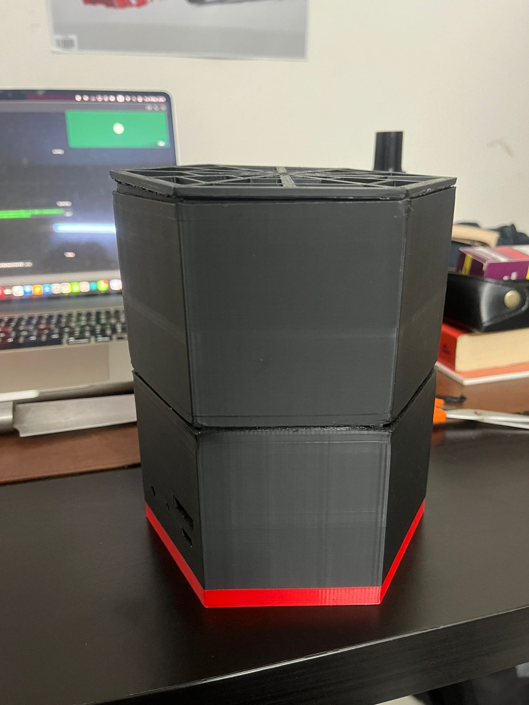
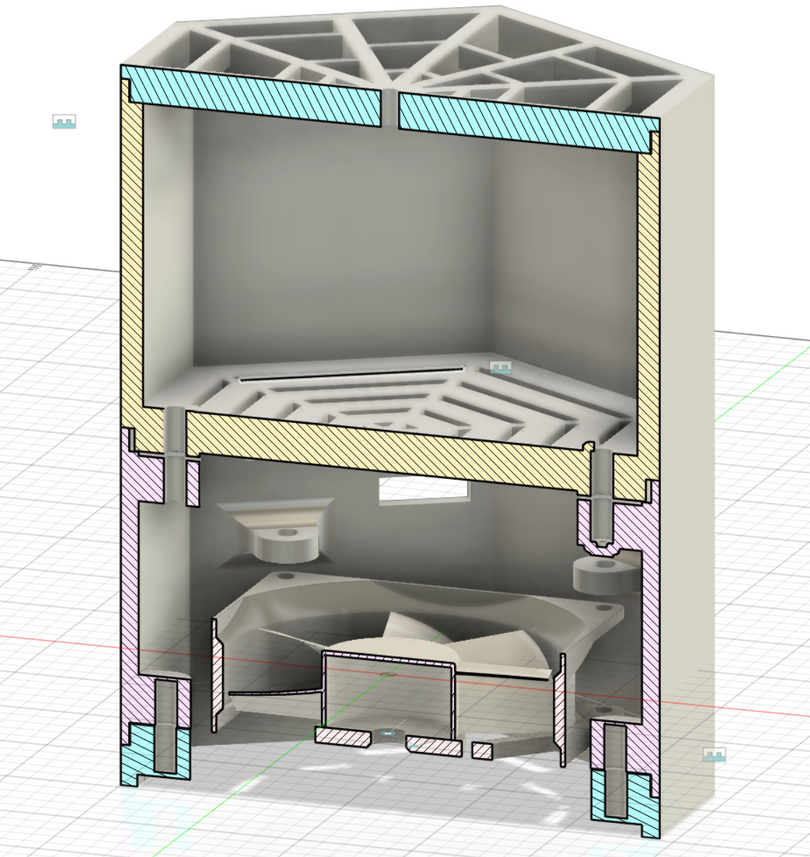
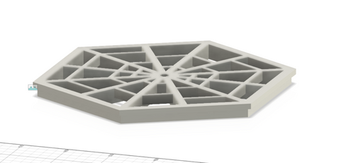
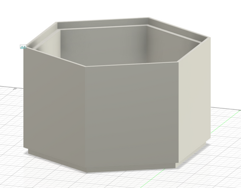
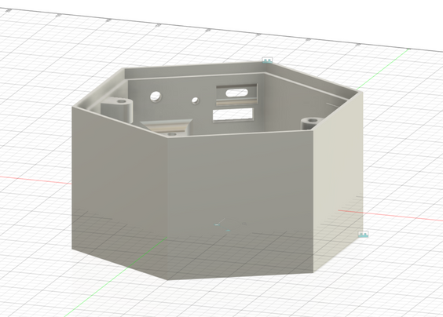
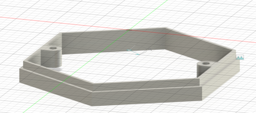

# HexaFresh — Footwear Odour Remover

HexaFresh is a tested footwear-deodorizing prototype developed as a semester product-design project. It combines fan-driven airflow with an activated-charcoal pouch inside a modular, 3D-printed enclosure. The device is powered through USB Type-C and is intended to reduce unpleasant footwear odour after use.

## My contribution

I worked on the project’s mechanical design, fabrication and electrical integration:

- **CAD design:** Designed the enclosure and its component layout, including the separate charcoal and electronics compartments.
- **3D printing:** Produced the printed enclosure parts for the physical prototype.
- **Wiring:** Wired the electronics for the Type-C-powered assembly.

This work connected the CAD design to a physical, working prototype that we could test.

## Design and operation

The hexagonal enclosure separates the activated-charcoal pouch from the fan and electronics. An 80 mm fan provides airflow through the ventilated structure, while the charcoal serves as the odour-adsorbing material. The detachable compartments allow access to the pouch and internal components.

The CAD section below shows the arrangement of the compartments and the fan within the enclosure.

### Enclosure components

| Ventilated cover | Charcoal compartment |
| --- | --- |
|  |  |
| Openings provide a path for airflow. | Separate chamber accommodates the charcoal pouch. |

| Electronics compartment | Base frame |
| --- | --- |
|  |  |
| Houses the fan and electrical components. | Forms the lower support of the enclosure assembly. |

## Prototype testing and result

We built and tested the prototype. After a few hours of use, we noticed a clear reduction in footwear odour. The result reported here is a qualitative observation based on smell, rather than a quantified reduction.

The project provided practical experience in enclosure design, 3D printing, electrical wiring and evaluating a product through prototype testing.

## CAD file

[Download the Fusion design file](cad/charcol-pouch.f3d)
